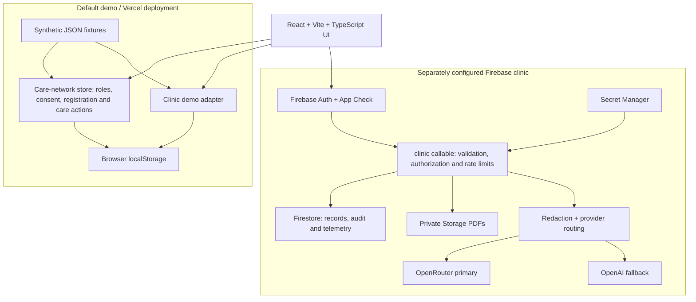

# CareDesk

### A clinic and pharmacy care workspace for patients, doctors, and pharmacists

A synthetic clinic workspace built with React, Vite, TypeScript, Node.js and Firebase. Designed with patient records, encounter notes, clinician-reviewed AI drafts, access control and audit trails.

The repository combines a **ready-to-run browser demo** with a **separate Firebase-backed clinic implementation**. Patients can share updates, doctors can record fictional prescriptions, pharmacists can document interventions, and administrators can review pharmacy registrations.

> **Synthetic data only. Not for clinical use.** The public demo uses browser storage and simulated roles. It does not send real prescriptions, text messages, emails, or calendar invitations. No HIPAA compliance claim is made.

[Quick start](#quick-start) · [Pages and features](#pages-and-features) · [Architecture](#architecture) · [Run modes](#run-modes) · [Documentation](#documentation)

## What the project contains

- **Patient care coordination:** self-reported updates, care profiles, care tasks, appointments, and a searchable timeline with CSV export.
- **Pharmacy onboarding:** persistent registration drafts, simulated phone verification, confirmation references, and administrator approval/rejection.
- **Patient-controlled sharing:** allow or revoke access to the example provider and pharmacy portals in the browser prototype.
- **Clinic records:** patient directory, encounters, clinical notes, encounter signing, and PDF attachments.
- **Backend engineering:** Firebase authentication, server-side role checks, audited callable operations, encrypted contact fields, request validation, and rate limiting.
- **AI note drafting:** a local template in demo mode; an OpenRouter/OpenAI gateway in configured Firebase mode.
- **Delivery and documentation:** automated tests, GitHub Actions workflows, Vercel configuration, architecture decisions, a threat model, and a technical-debt register.

## Quick start

Use **Node.js 22** and npm. Run these commands from the folder containing `package.json`:

```sh
npm ci
npm run dev
```

Open the URL printed by Vite, normally `http://127.0.0.1:5173/`.

The default demo needs **no API keys, Firebase account, or login**. Use **View as** to explore Patient, Doctor, Pharmacy, Super admin, and Front desk. Role switching is a simulation for reviewing workflows, not an authentication system.

### Suggested first walkthrough

1. Select **Patient → Care coordination**. Explore Alex Morgan's profile, add an update, and create a care task or visit request.
2. Select **Doctor → Care coordination**. Review shared information and add a fictional prescription record.
3. Select **Pharmacy → Care coordination**. Review the prescription and add an intervention without changing the prescriber's record.
4. Select **Patient → Consent & privacy**. Revoke pharmacy sharing, then return to Pharmacy to see Alex disappear from its available vaults.
5. Select **Pharmacy → Pharmacy registration**. Enter fictional business details, generate a visible demo code, and submit the registration.
6. Select **Super admin → Pharmacy registration**. Find the submission, approve it, and check the active/pending counts.
7. Open **Workspace** as Doctor. Select a patient and encounter, save a note, then sign the encounter to lock further note additions.

## Pages and features

The sidebar contains four care-network pages, the clinic Workspace, and two administrator pages. In this version, the four care-network pages are available **only in browser demo mode**.

### 1. Care network

The entry dashboard explains the patient → doctor → pharmacy care journey and provides shortcuts to the relevant workflows.

- Patient and care-team views show counts derived from the records accessible to that simulated role.
- Super admin sees registered, active, and pending pharmacy counts, plus recent local network actions.
- Workflow cards introduce patient updates, doctor-authored prescriptions, and pharmacist follow-up.
- Privacy controls explain why consent is required before accessing a patient's network records.

Counts come from the current demo state. The project does not invent provider usage statistics or clinical outcomes.

### 2. Pharmacy registration

Pharmacy and Super admin can submit fictional organization details: pharmacy name, primary contact, email, phone, registration/license ID, and address.

**Registration flow:**

```text
Enter details → Save draft → Generate demo code → Verify and submit
                                                   ↓
                                         Pending registration
                                                   ↓
                                      Admin approves or rejects
```

- Fields save as they are edited. Leaving/reopening the page or reloading does not erase the saved draft for that demo actor.
- The verification panel displays the **simulated code** and clearly states that no SMS was sent.
- Codes expire after 10 minutes; resend has a 30-second cooldown; verification permits up to five attempts. Changing the phone invalidates the previous code.
- Successful submission produces a confirmation reference and a pending entry. Duplicate emails or license IDs are rejected.
- Super admin can search the directory, filter active/pending/rejected records, and approve or reject pending registrations.
- Total, active, and pending counts are calculated from saved registration state and update after each decision.

Registration does not create a real Firebase account, verify a legal pharmacy license, sign a BAA, or connect an external pharmacy system. The example Pharmacy portal continues to represent Northstar; adding an organization does not switch that actor's membership.

### 3. Care coordination

A patient-centered workspace for the Patient, Doctor, and Pharmacy demo portals. Doctors and pharmacists see only the example records permitted by the current simulated consent state. Super admin and Front desk do not use this network clinical workspace.

| Tab | What it shows | Available functions |
| --- | --- | --- |
| **Care overview** | Care focus, coordinator, contact preferences, enrollment date, and coordination notes | Review the profile, completed task count, and planned/requested visit count. Task progress is not a health score. |
| **Care plans** | Coordination tasks with descriptions, due dates, authors, and status | Add a task; change its status to planned, in progress, or completed; search and filter tasks within the accessible patient record. |
| **Appointments** | Fictional video, telephone, and in-person visit records | Patients request visits; care-team users schedule or confirm them. Patients can cancel eligible visits; care-team users can complete or cancel them. Completed/cancelled entries are not reopened through these actions. |
| **Care timeline** | A combined view of reports, prescriptions, interventions, care goals, and appointments | Search, filter by record type, and export the filtered view as CSV. Formula-like cell prefixes are neutralized for spreadsheet export. |
| **Patient reports** | Patient-entered wellbeing updates, measurements, concerns, and care goals | Patients add their own fictional updates. Care-team users can review shared information. Entries remain labeled as unverified self-reports. |
| **Prescriptions** | Doctor-authored medication labels and instructions | Doctors add fictional prescription records. Patients and pharmacists can review permitted records; pharmacy interventions do not edit them. |
| **Interventions** | Pharmacist follow-up, reconciliation, education, and clarification notes | Pharmacists add interventions and mark open interventions resolved. Other permitted users can review them. |

Appointments do not launch calls or send invitations. Prescription records are not electronic prescriptions or dispensing orders. The timeline is a record view, not a security audit log.

Health score is **not calculated**, medication adherence is **unknown**, and external connections remain **not connected** when the required data or integrations are unavailable.

### 4. Consent & privacy

The example patient, Alex Morgan, controls whether the provider portal and Northstar pharmacy portal can access the fictional network vault.

- The Patient demo role can enable or revoke each permission.
- Other roles can inspect the example controls but cannot change them.
- Revocation removes the record from the affected portal's available patient list and blocks subsequent simulated care actions.
- Open tabs receive network-state updates through the browser storage event.

This demonstrates a consent workflow. Because the prototype stores its data in localStorage, it is not a secure authorization boundary or a legally validated consent-management system. These preferences do not change the separate clinic Workspace permissions.

### 5. Workspace

The original clinic record-management page, available in browser demo and configured Firebase modes.

- Search the patient directory and open demographics.
- Create fictional patient records as an authorized staff role.
- Create encounters and review visit history.
- Review clinical notes; authorized clinical users can append notes and sign encounters.
- Signed encounters reject further note additions. Saved notes have no edit/delete interface.
- Upload and download synthetic PDF attachments, up to 750 KB, with role restrictions.
- Prepare a SOAP-style note draft, review it, and explicitly save it.

**Drafting differs by mode:** the browser demo uses a local text template and makes no LLM request. Configured Firebase mode can route redacted fictional text through external providers. Neither draft path replaces clinician review.

### 6. Audit trail

An administrator page for inspecting clinic activity and, in Firebase mode, assigning user roles.

- Show the latest 100 loaded clinic events: actor, action, patient, timestamp, and outcome.
- Filter those loaded events by actor, patient, or action.
- Assign roles to existing Firebase users when the authenticated backend is configured. Assignment is disabled in browser demo mode.

Firebase events are written by Functions; direct client audit writes are denied. Browser demo events are editable local data and do not provide tamper-resistant auditing. The care-network dashboard's local activity history is separate from this clinic audit page.

### 7. AI operations

An administrator view of real provider-attempt telemetry from the configured Firebase note-drafting gateway.

- Show provider/model, latency, token usage, reported cost, and status.
- Calculate success rate and p95 latency over the latest 100 loaded attempts.
- Display unavailable cost as unavailable rather than treating it as zero.
- Keep clinical prompts and responses out of the usage telemetry.

This page is intentionally empty in the default demo: local template drafts do not create fabricated LLM metrics. Attempt-level success rate is not the same as end-to-end request reliability.

### Sign-in screen

Firebase mode starts with email/password sign-in. The backend reads current Firebase Auth custom claims to authorize operations. The initial administrator is created through an operator bootstrap script; pharmacy demo registration does not provision these accounts.

## Roles and scope

The UI labels Doctor, Pharmacy, and Super admin correspond to `clinician`, `pharmacist`, and `admin` in the demo code.

| Role | Care-network demo | Clinic Workspace |
| --- | --- | --- |
| Patient | Own example vault, self-reports, tasks, visit requests, and sharing preferences | Own linked patient record, encounter metadata, notes, and documents |
| Doctor | Consent-approved records, fictional prescriptions, tasks, and appointments | Patient/encounter creation, clinical notes, signing, drafts, and documents |
| Pharmacy | Consent-approved records, interventions, tasks, appointments, and registration submission | No pharmacy-specific clinical access is implemented |
| Super admin | Pharmacy registration/review, directory, counts, and network activity; no network clinical editing | Administrative and clinical clinic access, audit/AI views, and Firebase role administration |
| Front desk | No clinical care-network access | Patient registration/demographics and encounter metadata; no clinical notes or documents |

**Pharmacy is a demo-network role.** The Firebase clinic backend implements admin, clinician, frontdesk, and patient roles; a production pharmacist/organization membership model remains future work.

## Architecture

### Two data paths, one React application



### Browser demo

- `src/main.tsx` provides navigation, role simulation, and the clinic UI.
- `src/network/CareNetwork.tsx` implements the care-network pages; `CareJourney.tsx` implements the overview, plans, appointments, and timeline tabs.
- `src/network/store.ts` validates and applies local network actions. `journey.ts` builds scoped timeline data and CSV output.
- `src/demo.ts` implements the separate clinic demo operations.
- `fixtures/clinic.json` and `fixtures/network.json` supply fictional records. Fixture upgrades add missing IDs while preserving existing saved work and consent/approval decisions.

Browser data belongs to the current origin and browser profile. It is not encrypted or synchronized across devices. Deploying on a different domain starts a separate demo state. The Workspace reset control resets the clinic demo store; the network uses a separate store.

### Firebase clinic backend

`src/api.ts` selects the demo adapter by default or connects to the Firebase callable when `VITE_MODE=firebase`.

Each authorized clinic operation passes through Functions rather than reading sensitive Firestore collections directly. Functions validate inputs with Zod, check the current server-side role and patient scope, apply rate limits, and record audit events before returning patient data. Direct Firestore and Storage SDK access is denied by rules.

Phone/address fields use AES-256-GCM with fresh nonces and authenticated patient/field context. Name, date of birth, and notes are not application-field-encrypted in this version. Core record mutations commit their success audit event in the same Firestore batch/transaction where possible. Storage and Auth operations span services and have documented consistency limits.

The AI gateway applies best-effort identifier redaction, tries OpenRouter first, and falls back to OpenAI after provider failure. Each provider has a 12-second timeout. Keys remain in Functions, and telemetry excludes prompt/output text. Redaction is not a guarantee of de-identification.

### Firestore model

```text
patients/{patientId}
  encounters/{encounterId}
    notes/{noteId}
  attachments/{attachmentId}
users/{uid}
auditLogs/{eventId}
llmRequests/{attemptId}
rateLimits/{counterId}
```

Subcollections scope visit history, notes, and attachment metadata to a patient. The patient-owner lookup plus name ordering has a checked-in composite index. Current Firebase lists are capped at 50 records for clinical lists and 100 for audit/telemetry; cursor pagination is planned.

The care-network browser model additionally contains pharmacies, consent preferences, coordination profiles, reports, prescriptions, interventions, goals, appointments, and local activity events. **These network entities are not yet backed by Firebase.**

## Run modes

| Capability | Default browser demo | Configured Firebase clinic |
| --- | --- | --- |
| Startup | No credentials required | Firebase project or emulator configuration required |
| Identity | Simulated role selector | Firebase Auth and server-side role checks |
| Clinic persistence | Browser localStorage | Firestore and Storage |
| Care-network pages | Available; local simulation | Not enabled in this mode |
| SOAP drafting | Local template | External gateway when provider secrets are configured |
| Contact-field encryption | Not implemented in browser storage | AES-256-GCM for phone/address |
| OTP / notifications | Visible demo code; no delivery | No production network OTP/notification implementation |
| Public Vercel build | Forces this mode | Deploy backend separately; see Firebase guide |

## Example dataset

All records describe fictional people, organizations, and scenarios.

| Dataset | Seeded records |
| --- | ---: |
| Patients / network care profiles | 12 / 12 |
| Clinic encounters / notes | 24 / 23 |
| Pharmacies | 8 |
| Patient-reported network updates | 51 |
| Fictional prescription records | 26 |
| Pharmacist interventions | 26 |
| Care tasks | 24 |
| Appointments | 24 |

Fixtures include open/signed encounters, active/pending/rejected pharmacies, open/resolved interventions, different task and appointment statuses, and allowed/revoked sharing scenarios. User-created records are additional. Fixture dates are a fictional November 2026 snapshot; seeded history is not live operational activity.

## Technology and repository layout

| Layer | Tools |
| --- | --- |
| Frontend | React, Vite, TypeScript, CSS, Lucide icons |
| Local demo | JSON fixtures, localStorage, typed domain actions |
| Backend | Node.js, Firebase Functions v2, Firebase Admin SDK |
| Identity and storage | Firebase Auth, App Check, Firestore, Storage, Secret Manager |
| Validation and testing | Zod, Vitest, Firebase rules-unit-testing, Emulator Suite |
| Delivery | Vercel for the demo; Firebase deployment configuration; GitHub Actions |

```text
src/
  main.tsx                 Navigation and clinic workspace UI
  api.ts                   Demo/Firebase clinic adapter selection
  demo.ts                  Browser-local clinic operations
  types.ts                 Shared frontend types
  network/
    CareNetwork.tsx        Network dashboard, registration and privacy pages
    CareJourney.tsx        Care overview, tasks, appointments and timeline UI
    store.ts               Network state, migration, validation and actions
    journey.ts             Timeline projection and CSV formatting
fixtures/                  Synthetic clinic and network JSON data
functions/src/
  index.ts                 Audited clinic callable and operation handling
  schema.ts                Callable request schemas
  security.ts              Access predicates, encryption and redaction
  llm.ts                   Provider fallback and attempt telemetry
tests/                     Unit, workflow, migration and security-rules tests
scripts/                   Demo build, emulator seed and admin bootstrap
docs/                      Architecture, deployment, decisions and limitations
.github/workflows/         Verification and gated Firebase deployment workflows
firestore.rules            Deny direct client database access
storage.rules              Deny direct client file access
vercel.json                Static demo build, rewrites and response headers
```

## Build and test

```sh
npm run typecheck       # Frontend and Functions TypeScript
npm test                # Unit, workflow and fixture/migration checks
npm run build:vercel    # Typecheck and build the public browser demo
npm run test:rules      # Firestore/Storage emulator security-rules checks
```

Use Java 21+ for emulator work. The packaged November 8, 2026 release passed **19 unit/workflow tests and 5 emulator rules tests**. See the [verification record](docs/VERIFICATION.md) for the exact scope and checks not performed.

Rules tests exercise direct SDK denial, including authenticated roles; legitimate clinic access goes through Functions. Unit tests cover policies and domain behavior, but do not constitute complete callable integration tests, clinical validation, or a production security assessment.

GitHub Actions runs compilation, unit tests, the frontend build, and emulator rules tests on pushes and pull requests. Firebase deployment is a separate manually triggered, environment-gated workflow. Vercel's connected Git project handles demo deployments after it is configured.

## Deploy on Vercel

Push this folder's contents to GitHub, then import the repository into Vercel. Select the directory containing `package.json` as the project root.

| Setting | Value |
| --- | --- |
| Framework | Vite |
| Node.js | 22.x |
| Install command | `npm ci` |
| Build command | `npm run build:vercel` |
| Output directory | `dist` |
| Environment variables | None for the demo |

The build script explicitly selects demo mode. Vercel serves the frontend; it does not deploy the Firebase Functions backend or make browser data shared between visitors.

Follow the [Vercel deployment guide](docs/VERCEL.md) for repository setup, import steps, and post-deployment checks.

## Configure the Firebase clinic

The authenticated clinic requires Firebase Auth, Firestore, Functions, Storage, App Check, and server secrets. Provider keys are required only for real gateway requests. Full setup, operator bootstrap, and deployment requirements are covered in the [Firebase deployment guide](docs/DEPLOYMENT.md).

For local backend development:

1. Run `node scripts/init-emulators.mjs` to create ignored emulator-only secrets.
2. Copy `.env.example` to `.env.local`, select `VITE_MODE=firebase`, and configure the emulator values described in the deployment guide.
3. Start `npm run emulators`.
4. In another terminal, set the Auth/Firestore emulator host variables and run `npm run seed`.
5. Restart Vite after changing its environment variables.

The seed refuses to run without emulator host settings. It creates four emulator-only accounts (`admin`, `clinician`, `frontdesk`, and `patient` at `caredesk.example`) with password `DemoOnly!2026`. These are local test accounts, not production credentials. Keep the emulator encryption key stable while reusing encrypted records. Signed file downloads need separate staging verification of service-account signing permissions.

## Boundaries and next steps

The repository demonstrates implementation patterns and reviewable product workflows. Before any real-data use, substantial work remains:

- Move network operations and consent enforcement to an authenticated backend with tenant memberships and patient/provider scope.
- Add real verification/notification delivery, pharmacy credential validation, and legally reviewed consent/agreement handling.
- Implement key rotation, malware scanning, lifecycle/retention policies, pagination, and stronger integration/accessibility testing.
- Review operational security, vendor agreements, backup/recovery, incident response, and applicable compliance obligations independently.

There is no live BestRx, FHIR, wearable, insurance/billing, remote-monitoring, or clinical decision-support integration. No health score or adherence result is inferred from missing data. See [technical debt](docs/TECHDEBT.md) and the [threat model](docs/THREAT_MODEL.md) for the current tradeoffs.

## Documentation

| Document | Purpose |
| --- | --- |
| [Architecture](docs/ARCHITECTURE.md) | Firebase clinic data model, queries, authorization, audit consistency, and AI routing |
| [Care-network scope](docs/CARE_NETWORK.md) | Browser prototype behavior, registration walkthrough, and production follow-up work |
| [Vercel deployment](docs/VERCEL.md) | Publish the synthetic demo from GitHub |
| [Firebase deployment](docs/DEPLOYMENT.md) | Configure the separate authenticated clinic backend |
| [Testing](docs/TESTING.md) | Automated test scope and manual staging scenarios |
| [Verification record](docs/VERIFICATION.md) | Executed checks and their limits |
| [Threat model](docs/THREAT_MODEL.md) | Assets, risks, implemented mitigations, and residual gaps |
| [ADR 0001](docs/adr/0001-audited-boundary.md) | Why sensitive clinic reads pass through audited callables |
| [Technical debt](docs/TECHDEBT.md) | Prioritized engineering follow-ups |
| [AI coding conventions](AGENTS.md) | Constraints for AI-assisted changes |

## Development approach and license

CareDesk was built with AI-assisted development. Architectural decisions, test results, and limitations are documented so contributors can review and understand the implementation. Contributions should preserve synthetic-only fixtures, server-side authorization in Firebase mode, and the distinction between simulated and connected services.

Licensed under the [MIT License](LICENSE). CareDesk is an independent portfolio project and is not affiliated with a clinic, pharmacy network, or employer.
