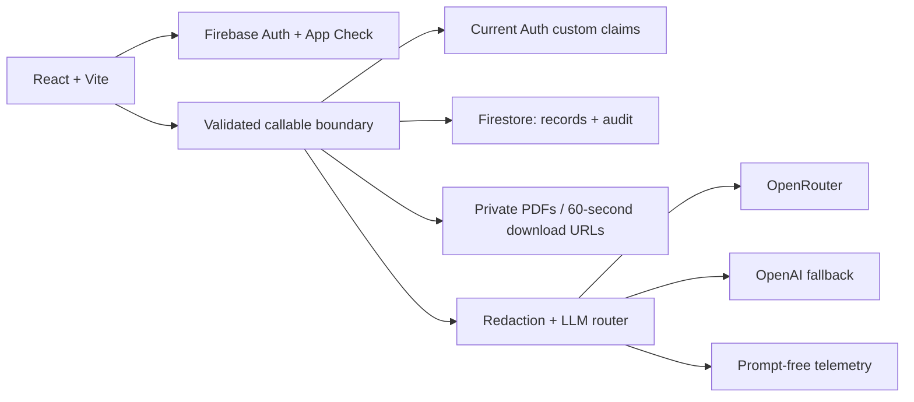

# Architecture

Two adapters expose the same operation contract. `src/demo.ts` runs only synthetic browser-local interactions. `src/api.ts` connects Firebase Auth/App Check and calls `clinic` in Firebase mode. The UI contains no provider keys and never directly queries patient collections.

## Collections and queries

| Path                           | Purpose / query                                                                  |
| ------------------------------ | -------------------------------------------------------------------------------- |
| patients/{id}                  | Name, DOB, owner UID, encrypted phone/address; name ascending limit 50           |
| patients/{id}/encounters/{id}  | Reason, clinician UID, status; createdAt descending limit 50                     |
| .../encounters/{id}/notes/{id} | Append-only authored text; createdAt descending limit 50                         |
| patients/{id}/attachments/{id} | Private Storage object path, display name, author, time                          |
| users/{uid}                    | Role mirror only; Auth claims remain authoritative                               |
| auditLogs/{id}                 | Append-only by application code; actor, action, patient, time, source, outcome   |
| llmRequests/{id}               | Provider attempt status, model, duration, tokens, cost or null; no prompt/output |
| rateLimits/{uid}               | Fixed minute-window counter, transactionally incremented                         |

Patient subcollections keep record ownership and paths explicit. Reading a patient does not load its descendants. Patient listings contain identity summaries, not decrypted contact details; opening a patient decrypts phone/address in Functions. Name and DOB remain plaintext for this demo's directory, which is a documented sensitivity tradeoff. Notes rely on platform encryption at rest, rather than application field encryption.

The owner query uses `patientUid == uid` plus `orderBy(name)`, requiring the checked-in composite index. Other scoped queries need only automatic single-field indexes. IDs and summary data in callable responses avoid fetching the same parent for every list row. No cross-patient collection group scan is used.

## Authorization matrix

| Operation                           | Admin | Clinician | Frontdesk | Patient           |
| ----------------------------------- | ----- | --------- | --------- | ----------------- |
| Patient directory / demographics    | Yes   | Yes       | Yes       | Own linked record |
| Create patient                      | Yes   | Yes       | Yes       | No                |
| Link patient Auth UID at creation   | Yes   | No        | No        | No                |
| Encounter metadata                  | Yes   | Yes       | Yes       | Own               |
| Create/sign encounter; append notes | Yes   | Yes       | No        | No                |
| Read notes / documents              | Yes   | Yes       | No        | Own               |
| Draft AI / upload PDFs              | Yes   | Yes       | No        | No                |
| Audit / metrics / assign roles      | Yes   | No        | No        | No                |

Clinicians currently have clinic-wide access; assignment-based care-team scopes are future work. Patients see saved notes, including open encounters; a release policy is required before a real portal. Patient ownership is immutable after creation in this version. No deletion/update UI is claimed; correction, retention and deletion need a separate lifecycle design.

## Consistency and audit

Patient creation, encounter creation, note append and encounter signing commit their success audit event atomically with the mutation. Note writes read encounter state in a transaction to avoid racing a sign operation. Lists/reads log before returning any result. Role and file operations span Auth/Storage/Firestore, so started/success events and upload compensation are used; these are not distributed transactions. Audit timestamps are generated on the server as ISO strings. Client writes to audits are impossible through SDK rules; privileged project operators can still alter Firestore. This is not WORM storage.

The callable checks current custom claims using Admin Auth instead of trusting a potentially stale role token. Role assignment is admin-only; self-role edits are disallowed. Refresh tokens are revoked, and the users mirror is updated. Admin SDK bypasses rules, so boundary authorization is essential.

## AI

Only the explicit draft action sends text externally. Known patient name, component names, DOB, decrypted phone/address plus email/number patterns are replaced. This is best-effort and over-redacts some benign numbers. Identifiers are not reinserted, keeping the clinician responsible for the final draft. Two OpenAI-compatible endpoints are tried sequentially with 12s timeouts. All attempts are recorded; provider output is untrusted plain text. Cost is nullable because not all providers report it. Dashboard p95/success metrics cover the latest 100 **attempts**, not end-to-end request reliability.

Global maximum instances and per-user/AI counters bound some abuse. They are not a spend ceiling. Configure provider budgets and alerts independently.
